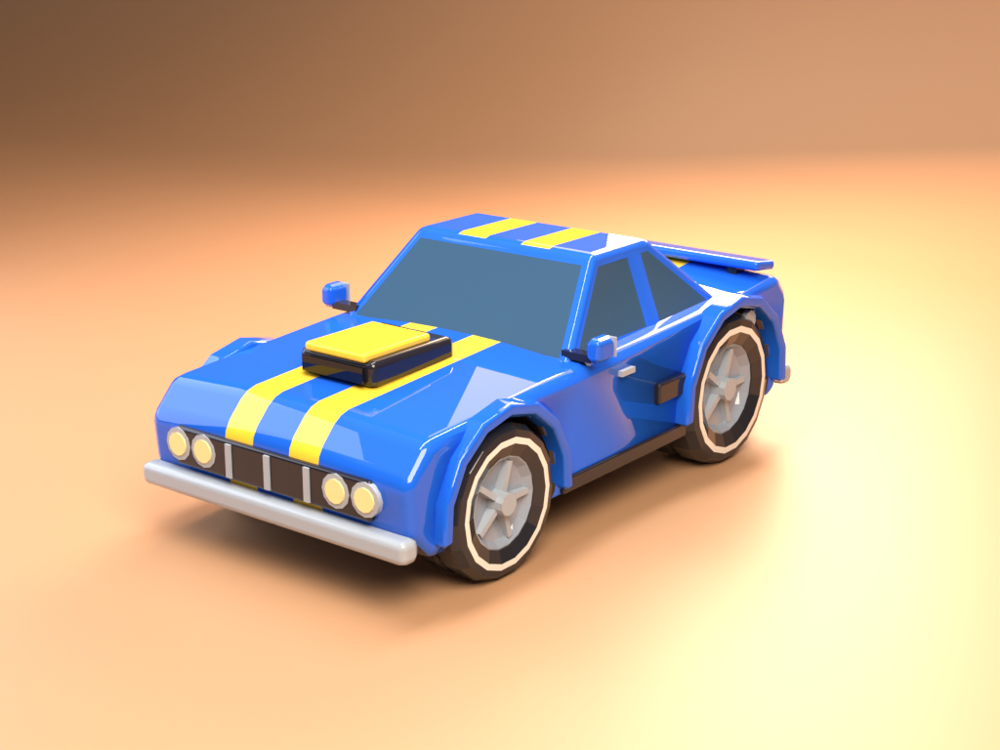
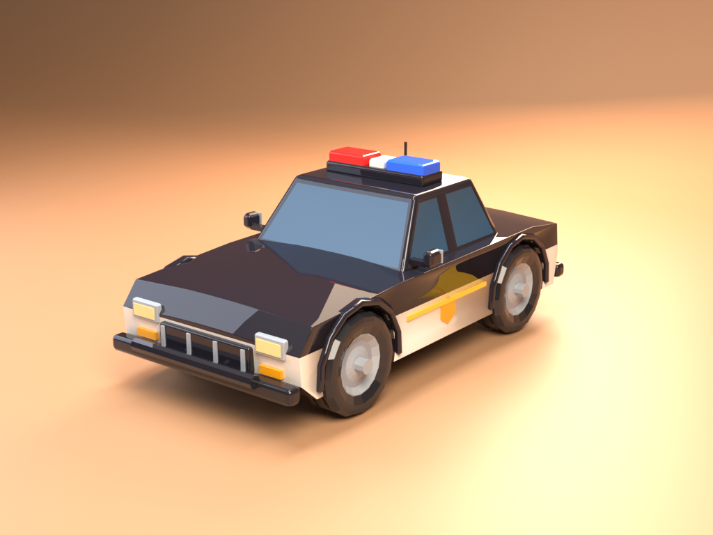
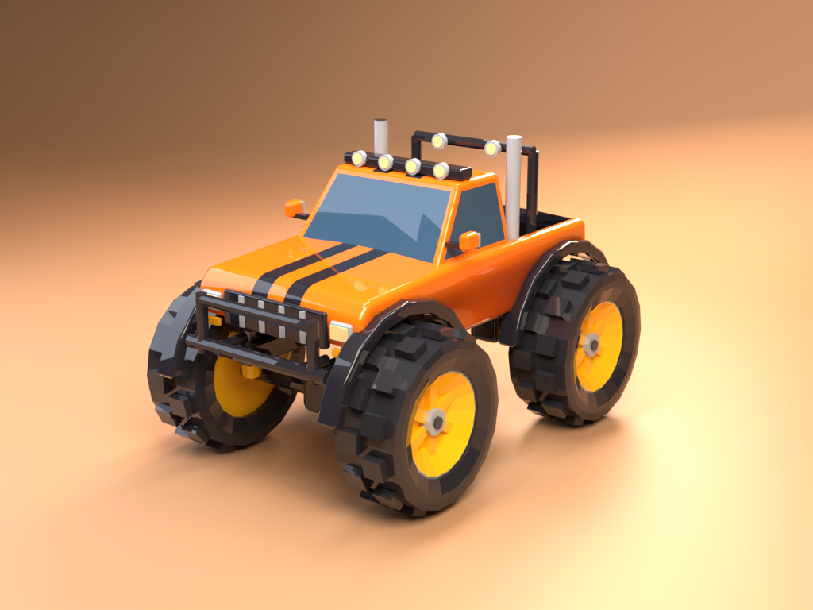

# Free Low-Poly Toy Cars (CC0): 5 vehicles with separate wheels

Five chunky low-poly toy cars, free and public domain: a muscle car, a police car, a fire truck, an ice cream van and a monster truck. The four wheels of each car are separate nodes, so you can spin them in code for racing and parking games. GLB and FBX, ready for Godot, Unity, Unreal Engine, Blender, three.js and Babylon.js. No credit needed, commercial use is fine.

| | | |
| --- | --- | --- |
|  |  |  |

They are five of the cars from my bigger [50 Low-Poly Toy Cars](https://vuena.itch.io/toy-cars-20) pack, and the files are the same ones that are in the full pack.

## What is inside

| Car | Colourway | Triangles | File |
| --- | --- | --- | --- |
| Muscle car | blue | 6664 | `GLB/02_muscle/muscle_blue.glb` |
| Monster truck | orange | 7804 | `GLB/09_monster/monster_orange.glb` |
| Police car | classic | 5783 | `GLB/14_police/police_classic.glb` |
| Ice cream van | pink | 6300 | `GLB/16_icecream/icecream_pink.glb` |
| Fire truck | red | 6388 | `GLB/18_fire/fire_red.glb` |

- 5 GLB + 5 FBX files, each in its own folder (`GLB/` and `FBX/`), with a 64x64 palette PNG and a metal/roughness PNG next to every GLB.
- **Not rigged and no animation clips.** The wheels are separate nodes named `wheel_FL`, `wheel_FR`, `wheel_RL` and `wheel_RR`. The origin of a wheel is its centre and the spin axis is its local X, so `rotate_x()` in Godot or `transform.Rotate` in Unity does the job.
- One material and one tiny palette texture per file. Every colour is a flat cell of the palette, so you can recolour a car by editing the PNG.
- 1 unit = 1 m, origin on the ground at the car centre, front = +Z, up = +Y.
- `vehicles.csv` and `manifest.json` list size and triangle count of every model.

```
GLB/            glTF 2.0 binary, one folder per car
FBX/            binary FBX with the palette embedded
vehicles.csv, manifest.json, CHANGELOG.md, PACK-NOTES.txt
Preview/        renders
LICENSE         the CC0 1.0 legal text
LICENSE.txt     the dedication that shipped inside the itch.io zip
```

## Good to know

- Stylised toys, not realistic vehicles. They are generic designs with no real brands, makes or logos.
- There is no interior, no steering rig and no suspension.
- Blender's FBX exporter puts the base palette into the emission slot, so emission is switched off in the FBX files.
- The lights, the road and the backdrop in the pictures are not in the files. I rendered them in Blender with lights I added.
- The whole 50-car pack was validated with the Khronos glTF Validator (0 errors, 0 warnings on all GLB files). I have not tested every FBX importer.

## Licence

**CC0 1.0 Universal (public domain).** Use the five cars in anything, commercial or not, with no credit and no need to ask me. The waiver covers only the files in this repo. The paid pack has its own royalty-free licence.

## How they were made, honestly

I build the cars procedurally with my own Blender Python code, then export to GLB and convert to FBX with Blender. I wrote that code with AI assistance. The meshes and textures themselves are not AI-generated.

## Want the rest?

The full pack is **[50 Low-Poly Toy Cars on itch.io](https://vuena.itch.io/toy-cars-20)**: 50 vehicles with 3 colourways each, 150 GLB + 150 FBX files. There are 45 more (taxi, rally car, hot rod, dragster, tow truck, school bus, digger, tractor, tuk-tuk, supercar, motorbike, train engine and more). It is also part of the [Vuena All-in-1](https://vuena.itch.io/complete-collection). Buying it is what keeps me making these, and the free cars stay free either way.

- Free sample on itch: https://vuena.itch.io/toy-cars-5-free
- Browse every model: https://models.popyca.com
- All packs: https://vuena.itch.io
